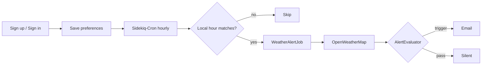

# DaySignal

Timezone-aware **weather alert delivery** for learning production Rails.

Users save a location, local alert time, timezone, and rain threshold. An hourly
job selects people due in **their** local hour, fetches a forecast, applies
**deterministic** rules (not an LLM), and emails them asynchronously via Sidekiq.

Built to practice patterns used by systems like
[Simple](https://docs.simple.org/) (Resolve to Save Lives): ActiveRecord,
Sidekiq, cron, Action Mailer, Hotwire. **Not a meteorology product** — an honest
learning app with a real end-to-end loop.

## Contents

1. [15-minute local demo](#15-minute-local-demo)
2. [Demo flow](#demo-flow)
3. [Architecture](#architecture)
4. [Stack](#stack)
5. [Docs](#docs)
6. [Manual checks](#manual-checks)
7. [Definition of done (MVP)](#definition-of-done-mvp)
8. [Layout](#layout)
9. [Environment](#environment)
10. [Current build step](#current-build-step)

## 15-minute local demo

```bash
# Prerequisites: rbenv Ruby 3.3.12, Docker Desktop, Redis
git clone <your-fork-or-path> DaySignal && cd DaySignal
cp .env.example .env   # add WEATHER_API_KEY (and SMTP later if you want)

docker compose up -d
redis-cli ping         # PONG

bundle install
bin/rails db:prepare
bin/rails db:seed

# Terminal A
bin/rails server

# Terminal B
bundle exec sidekiq -C config/sidekiq.yml
```

1. Open http://localhost:3000 — sign in as `demo@daysignal.local` / `password123`
2. Confirm preferences (Lagos, 07:00, threshold 50%) — or search a city; lat/lng/timezone autofill
3. Health: http://localhost:3000/up
4. Optional live forecast: `EMAIL=demo@daysignal.local bin/rails weather:evaluate`
5. Optional email preview: lower threshold to `0` in the UI, then
   `EMAIL=demo@daysignal.local bin/rails alerts:deliver_one`
   (Letter Opener opens a browser tab; set `MAILER_DELIVERY_METHOD=smtp` for Gmail)

Automated safety net: `bin/rails test` (includes Manual QA scenarios).

Spoken demo script: [`docs/walkthrough.md`](docs/walkthrough.md).

## Demo flow



## Architecture

```text
User saves preferences (Rails + Postgres)
        ↓
Sidekiq-Cron every hour → DispatchDueAlertsJob
        ↓
Only users whose LOCAL hour matches → WeatherAlertJob
        ↓
Faraday → OpenWeatherMap → Forecast DTO
        ↓
AlertEvaluator (POP / heavy rain rules in Ruby)
        ↓
If triggered → Action Mailer (Letter Opener or SMTP)
```

Idempotency: at most one alert stamp per user per **local** calendar day
(`last_alerted_at`).

## Stack

Rails 8 · PostgreSQL (Docker) · Redis · Sidekiq · Sidekiq-Cron · Faraday ·
Action Mailer · Hotwire (Turbo + Stimulus) · ERB

## Docs

| Doc | Purpose |
| --- | --- |
| [`APPROACH.md`](APPROACH.md) | Product rules and architecture bible |
| [`docs/BUILD_PLAN.md`](docs/BUILD_PLAN.md) | Step tracker — read *Current position* first |
| [`docs/pitch.md`](docs/pitch.md) | Interview pitch: use cases → files → Simple skills |
| [`docs/walkthrough.md`](docs/walkthrough.md) | 5–7 minute live/recording script |
| [`docs/responsible_ops.md`](docs/responsible_ops.md) | Secrets, PII, retries, hard “never” rules |
| [`docs/adr/`](docs/adr/) | Architecture decision records |
| [`docs/definitions.md`](docs/definitions.md) | Forecast window + trigger rules |
| [`docs/scheduling.md`](docs/scheduling.md) | Timezone dispatch details |
| [`docs/weather_provider.md`](docs/weather_provider.md) | OpenWeatherMap 2.5 choice |

## Manual checks

Encoded as `test/integration/manual_qa_test.rb` (APPROACH §13):

| # | Scenario | Covered by tests |
| --- | --- | --- |
| 1 | Lagos due hour + trigger path → mail | yes |
| 2 | High threshold + low POP → no mail | yes |
| 3 | Wrong local hour → not dispatched | yes |
| 4 | Alerts disabled → not dispatched | yes |
| 5 | Bad API key fails job; prefs UI still works | yes |
| 6 | Prefs UI works without Sidekiq worker | yes |

```bash
bin/rails test test/integration/manual_qa_test.rb
```

## Definition of done (MVP)

Checklist for “this is demoable”:

- [x] Create an account and sign in
- [x] Save location, timezone, alert time, rain threshold (search or manual lat/lng)
- [x] Selected by the hourly dispatcher in the user’s local hour
- [x] Email when the threshold is met (Letter Opener or SMTP)
- [x] No email when the threshold is not met
- [x] Turn alerts off → stop being selected
- [x] Jobs via Sidekiq + Redis; Sidekiq-Cron schedule present
- [x] Timezone + Manual QA tests green (`bin/rails test`)
- [x] Weather API stubbed in CI (no live network in automated tests)
- [x] README enough for a third party to run locally in ~15 minutes
- [x] Pitch package: [`docs/pitch.md`](docs/pitch.md), walkthrough, responsible ops
- [ ] Optional VPS deploy with public URL (BUILD_PLAN Step 5.6)
- [ ] Résumé / portfolio links after deploy or local-demo preference (Step 5.7)

## Layout

```
app/
  models/          # User + alert preferences
  services/        # WeatherClient, Forecast, AlertEvaluator, geocoding
  jobs/            # DispatchDueAlertsJob, WeatherAlertJob
  mailers/         # WeatherMailer
  controllers/     # Auth, preferences, geocodings
  javascript/      # Stimulus (location picker, theme)
config/
  sidekiq.yml      # concurrency capped for small hosts
  schedule.yml     # hourly cron
docker-compose.yml # Postgres 16 → host :5433
docs/              # pitch, walkthrough, ADRs, scheduling
```

## Environment

Copy `.env.example` → `.env`. Never commit `.env`.

| Variable | Purpose |
| --- | --- |
| `POSTGRES_*` | Docker Postgres (host port **5433** locally) |
| `REDIS_URL` | Sidekiq broker |
| `WEATHER_API_KEY` | OpenWeatherMap (live only; tests stub) |
| `MAILER_DELIVERY_METHOD` | `letter_opener` (default) or `smtp` |
| `SMTP_*` / `MAILER_FROM` | Gmail (or other) when using SMTP |

## Current build step

See **Current position** in [`docs/BUILD_PLAN.md`](docs/BUILD_PLAN.md).
